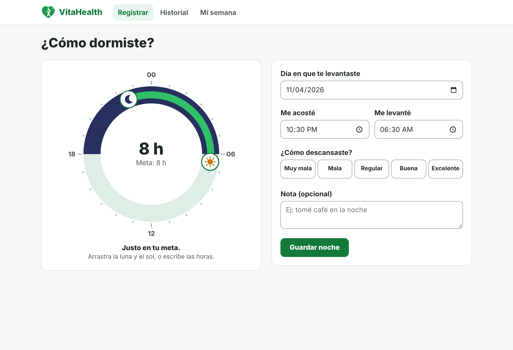
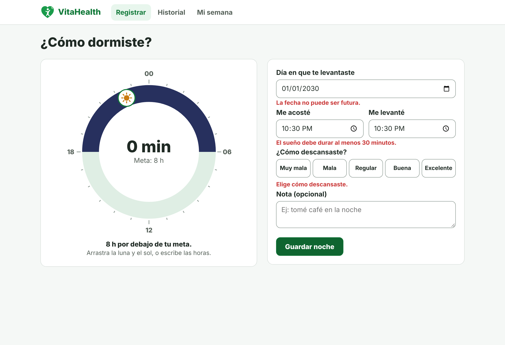
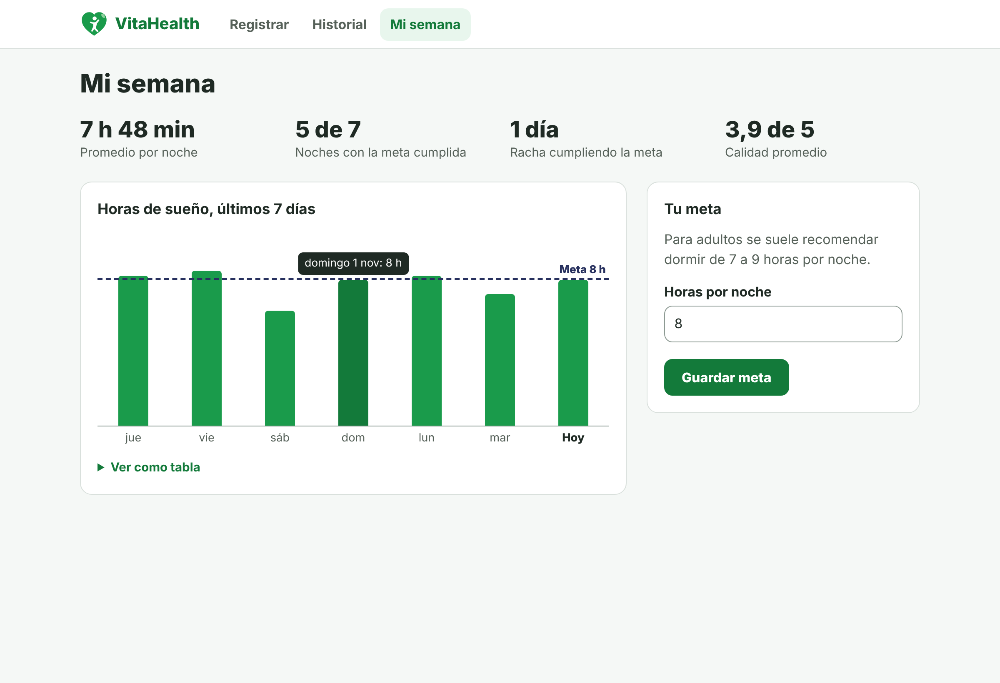
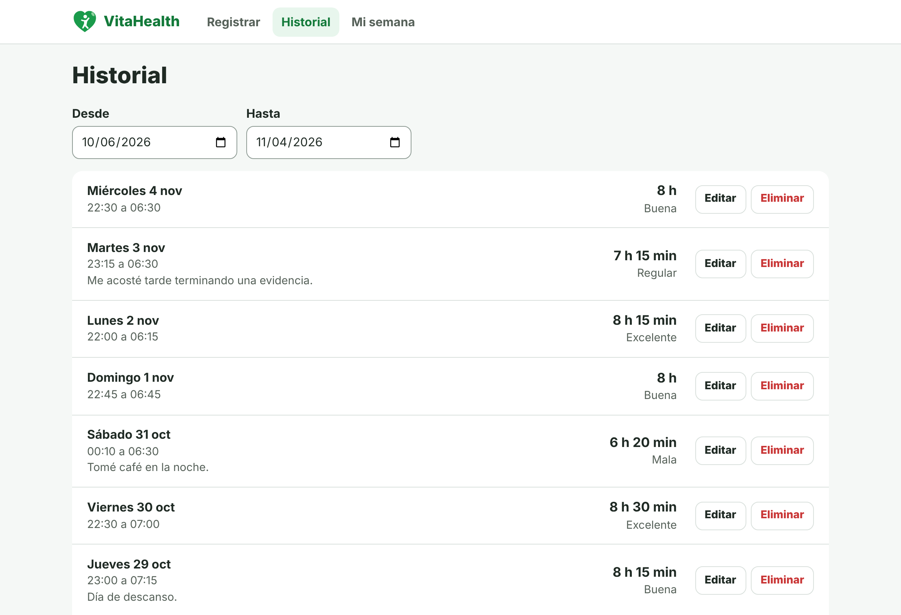

# VitaHealth: módulo front-end de sueño

**Evidencia GA7-220501096-AA4-EV03: Componente front-end del proyecto formativo y proyectos de clase**

| | |
|---|---|
| **Aprendiz** | Ingri Daniela Rojas Sánchez |
| **Equipo** | Luisa Fernanda Betancur Idarraga, Luna Michell Montealegre |
| **Instructor** | Roberto Echeverri Arroyave |
| **Programa** | Análisis y Desarrollo de Software (ADSO), SENA |
| **Tipo de proyecto** | Web |
| **Repositorio** | https://github.com/Vitahealth05/vitahealth-sueno |



Este módulo codifica la parte de **sueño** del módulo funcional "Hidratación, sueño y hábitos" definido en los
estándares del equipo (AA1-EV02). Esa parte no estaba construida en `vitahealth-web` ni en `vitahealth-habitos`.

## Funcionalidades

- Registrar una noche con un **reloj de 24 horas** que se arrastra, se maneja con teclado o se llena con los campos de hora.
- Calcular la duración aunque la noche cruce la medianoche y compararla con la meta.
- Consultar el historial, filtrarlo por fechas, editar y eliminar con confirmación.
- Ver el resumen de 7 días: promedio, noches con la meta cumplida, racha, calidad y gráfico.
- Definir la meta diaria (4 a 12 horas).
- Cargar datos de ejemplo para demostrar el módulo.

## Tecnologías

| Componente | Uso |
|---|---|
| React 19 (componentes y hooks) | Interfaz |
| JavaScript ES2022, JSX, HTML5, CSS3 (BEM) | Código del front-end |
| esbuild | Empaquetado y servidor de desarrollo |
| localStorage | Persistencia en el navegador, aislada en `RepositorioSueno` |
| `node:test` | Pruebas unitarias |
| ESLint, Prettier, EditorConfig | Estándares de codificación |
| Git y GitHub | Versionamiento con Conventional Commits |

## Ejecución

**Sin instalar nada:** en la carpeta entregada, abrir `dist/index.html` con doble clic.

**Desde el código** (requiere Node.js 20 o superior):

```bash
npm install
npm run dev      # http://localhost:5173
```

| Comando | Descripción |
|---|---|
| `npm run build` | Genera la carpeta `dist/` |
| `npm test` | Ejecuta las pruebas unitarias |
| `npm run lint` | Revisa el estándar con ESLint |
| `npm run format` | Da formato con Prettier |

## Estructura

```
src/
├── main.jsx, App.jsx    Punto de entrada y componente raíz
├── paginas/             Registrar, Historial y Mi semana
├── componentes/         Reloj, formulario, gráfico, modal, aviso y barra superior
├── hooks/               useSueno (estado) y useRuta (navegación por hash)
├── modelo/              Reglas de negocio y estadísticas, sin dependencia de React
├── servicios/           Repositorio en localStorage y datos de ejemplo
├── utilidades/          Fechas y horas
└── estilos/             Hoja de estilos (BEM)
tests/                   Pruebas unitarias
docs/                    Trazabilidad, plan de pruebas y capturas
```

La interfaz solo accede a los datos por medio de `RepositorioSueno`, de modo que puede cambiarse por una API REST sin
tocar los componentes. Los datos quedan en el navegador porque el módulo todavía no está conectado a un servidor.

Ver [`docs/TRAZABILIDAD.md`](docs/TRAZABILIDAD.md).

## Capturas

| Validaciones | Mi semana | Historial |
|---|---|---|
|  |  |  |
